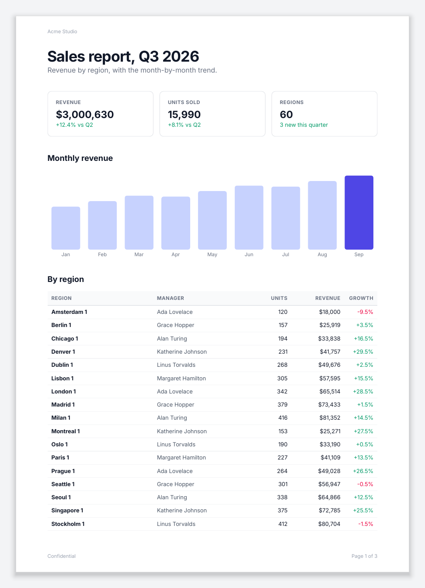
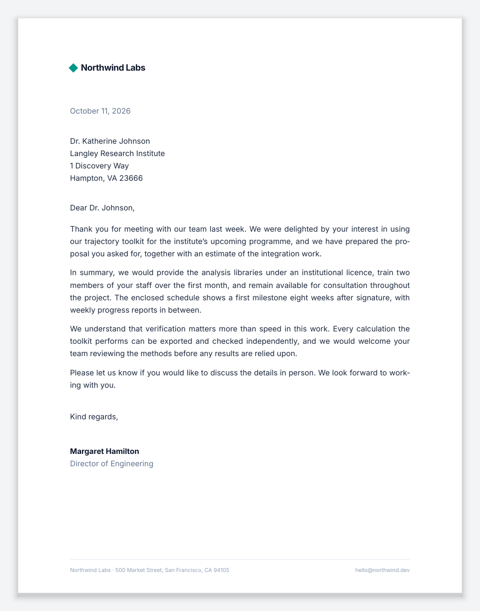
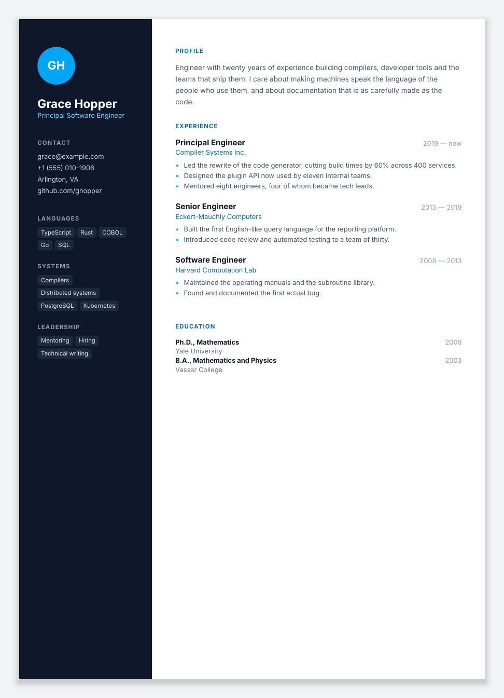
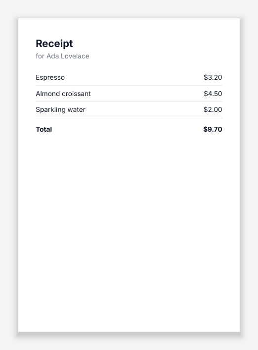

<div align="center">

# Inkoxide

**A PDF layout engine for Node.js, written in Rust.**

Typeset documents from React components, or from a JSON document tree.

[](https://www.npmjs.com/package/@inkoxide/render)
[](https://www.npmjs.com/package/inkoxide)
[](#licence)

[Getting started](#getting-started) · [Documentation](#documentation) · [Performance](#performance) · [Platforms](#platforms)

</div>

<table>
<tr>
<td align="center" valign="top" width="33%"><br><sub><b>Invoice</b></sub></td>
<td align="center" valign="top" width="33%"><br><sub><b>Multi-page report</b></sub></td>
<td align="center" valign="top" width="33%"><br><sub><b>Certificate</b></sub></td>
</tr>
<tr>
<td align="center" valign="top" width="33%"><br><sub><b>Business letter</b></sub></td>
<td align="center" valign="top" width="33%"><br><sub><b>Résumé</b></sub></td>
<td align="center" valign="top" width="33%"><br><sub><b>Fillable form</b></sub></td>
</tr>
</table>

Inkoxide does the typesetting of a PDF: text shaping, line breaking, layout, pagination and PDF
output, in native code. Documents are written as React components with
[`@inkoxide/render`](https://www.npmjs.com/package/@inkoxide/render), styled with Tailwind
classes or style objects, or built as JSON by any program and rendered with
[`inkoxide`](https://www.npmjs.com/package/inkoxide). A one-page invoice renders in about a
millisecond; a 98-page report with 40 tables in about 130 ms.

## Features

- **Typesetting.** OpenType shaping, justification, hyphenation with TeX patterns, orphans and
  widows, font fallback and right-to-left text.
- **Layout.** Flexbox and CSS grid, absolute positioning, transforms, borders and radii.
- **Pagination.** Tables that split across pages with repeating header rows, headers and
  footers, page numbers, keep-together blocks and page breaks.
- **Content.** JPEG, PNG, GIF, WebP and SVG images, vector drawing, links, bookmarks and
  fillable form fields.
- **Output.** Font subsetting (TrueType and CFF), PDF/A-2b, parallel rendering across pages,
  and byte-identical output for identical input.
- **Validation.** Every document is checked against a JSON Schema, with the path of each error.
  In React, errors carry the component stack.

## Getting started

### With React

```sh
npm install @inkoxide/render react
```

```tsx
import { Document, Page, renderToFile, Text, View } from '@inkoxide/render';

function Receipt({ customer, lines }: { customer: string; lines: { name: string; amount: number }[] }) {
  const total = lines.reduce((sum, l) => sum + l.amount, 0);
  return (
    <Document title={`Receipt for ${customer}`}>
      <Page size="A6" className="p-8 text-xs text-gray-900">
        <Text className="text-lg font-bold">Receipt</Text>
        <Text className="mb-4 text-gray-500">for {customer}</Text>
        {lines.map((l) => (
          <View key={l.name} className="flex-row justify-between border-b border-gray-200 py-1.5">
            <Text>{l.name}</Text>
            <Text>${l.amount.toFixed(2)}</Text>
          </View>
        ))}
        <View className="mt-3 flex-row justify-between font-bold">
          <Text>Total</Text>
          <Text>${total.toFixed(2)}</Text>
        </View>
      </Page>
    </Document>
  );
}

await renderToFile(
  <Receipt
    customer="Ada Lovelace"
    lines={[
      { name: 'Espresso', amount: 3.2 },
      { name: 'Almond croissant', amount: 4.5 },
      { name: 'Sparkling water', amount: 2 },
    ]}
  />,
  'receipt.pdf',
);
```



Run it with `npx tsx receipt.tsx`. The fonts (Inter, Noto Sans, Roboto Mono) and the Tailwind
compiler ship with the package. The [@inkoxide/render README](https://www.npmjs.com/package/@inkoxide/render)
has the six documents above with their code.

### With JSON

```js
import { readFileSync, writeFileSync } from 'node:fs';
import { registerFont, render } from 'inkoxide';

registerFont('Inter-Bold', readFileSync('Inter-Bold.ttf'));

const doc = {
  version: 1,
  fonts: [{ id: 'Inter-Bold', family: 'Inter', weight: 700 }],
  pages: [
    {
      size: { width: 595.28, height: 841.89 },
      margin: { top: 56, right: 56, bottom: 56, left: 56 },
      children: [{ type: 'text', runs: [{ text: 'Hello, PDF', font: 'Inter-Bold', size: 28 }] }],
    },
  ],
};

writeFileSync('hello.pdf', await render(JSON.stringify(doc)));
```

The document tree is a fully resolved description of boxes, text, images and tables, as JSON or
MessagePack. `@inkoxide/schema` has its TypeScript types and JSON Schema.

## Documentation

| Topic | Document |
|---|---|
| Writing documents in React | [Guide](docs/react/GUIDE.md): components, styling, fonts, images, pagination, tables, forms, API, errors |
| Moving from react-pdf | [Migration guide](docs/react/MIGRATING.md) |
| Using the engine from Node | [Client integration](docs/CLIENT_INTEGRATION.md): fonts, images, errors, threading, determinism, hyphenation |
| The engine API | [API](docs/API.md): the Rust and Node APIs, options and error codes |
| The document tree | [Schema reference](docs/SCHEMA.md) and [example documents](schema/EXAMPLES.md) |
| How it works | [Architecture](docs/ARCHITECTURE.md) and the [decision log](docs/DECISIONS.md) |
| Testing and benchmarks | [Testing](docs/TESTING.md) and [benchmarks](docs/BENCHMARKS.md) |

## Performance

Median render times after warm-up:

| Document | Pages | All cores | One thread | Machine |
|---|---:|---:|---:|---|
| Invoice, from React | 1 | 1.3 ms | 1.0 ms | Apple M4 Pro, Node 24 |
| Report, from React: 40 sections, 1,000 table rows | 43 | 33 ms | 44 ms | Apple M4 Pro, Node 24 |
| Report, from JSON: 40 tables, header, footer | 98 | 130 ms | 277 ms | 4-vCPU Xeon container |

Layout and PDF writing run in parallel across pages, and fonts are parsed once per process.
[docs/BENCHMARKS.md](docs/BENCHMARKS.md) has the methodology, per-stage profiles and comparisons
with other libraries.

## Platforms

Prebuilt binaries for Node.js 22 or later; npm installs the one for the current platform:

| OS | Architectures |
|---|---|
| macOS | arm64, x64 |
| Linux | x64 (glibc and musl), arm64 (glibc) |
| Windows | x64 |

## Development

```sh
git clone https://github.com/eddiesr93/inkoxide && cd inkoxide
scripts/ci.sh            # build and test everything
scripts/ci.sh --quick    # format, tests and schema
scripts/build-node.sh    # build the Node package in npm/
```

You need Rust (rustup picks 1.97.0 from `rust-toolchain.toml`), Node.js 22 or later, pnpm,
Python 3 with `jsonschema`, `numpy` and `Pillow`, and poppler for the visual tests; `qpdf`,
`cargo-deny` and `cargo-fuzz` are optional. [docs/TESTING.md](docs/TESTING.md) describes the
test suites. The command-line tool renders a JSON document directly:

```sh
cargo run --release -p inkoxide-cli -- \
  render fixtures/docs/invoice.json --fonts fixtures/fonts -o invoice.pdf
```

| Path | Contents |
|---|---|
| `crates/core` | The engine (crate `inkoxide`) |
| `crates/node`, `npm/` | The Node binding and its npm package |
| `crates/cli` | The `inkoxide` command-line tool |
| `schema/`, `npm-schema/` | The document schema and `@inkoxide/schema` |
| `fixtures/` | Input documents, fonts, images and expected renders |
| `examples/node-smoke` | A client-style test of the npm packages |

## Licence

MIT. The fixture fonts are under the SIL Open Font License (`fixtures/fonts/*-OFL.txt`).
