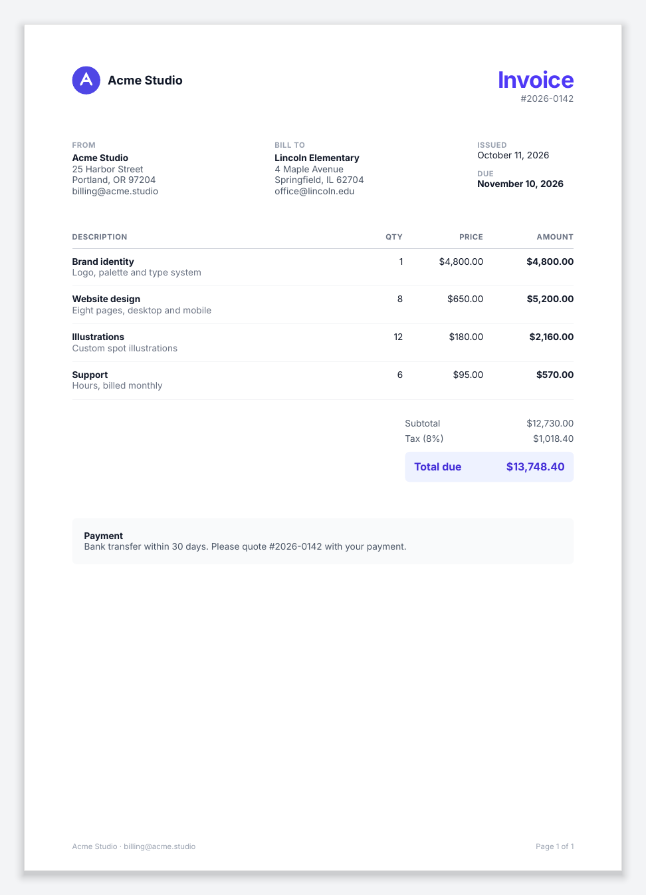
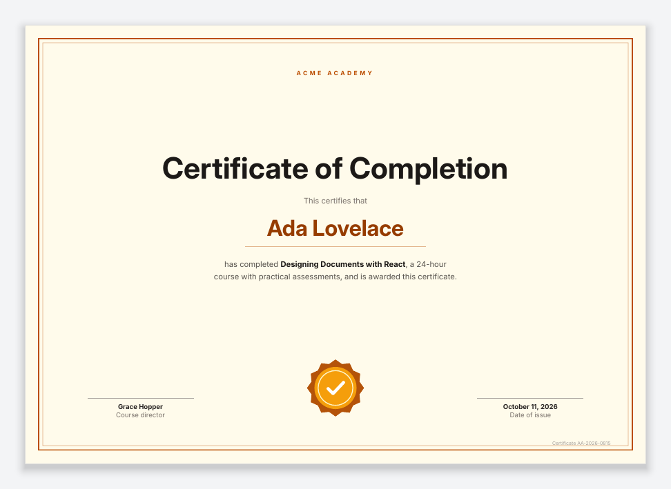
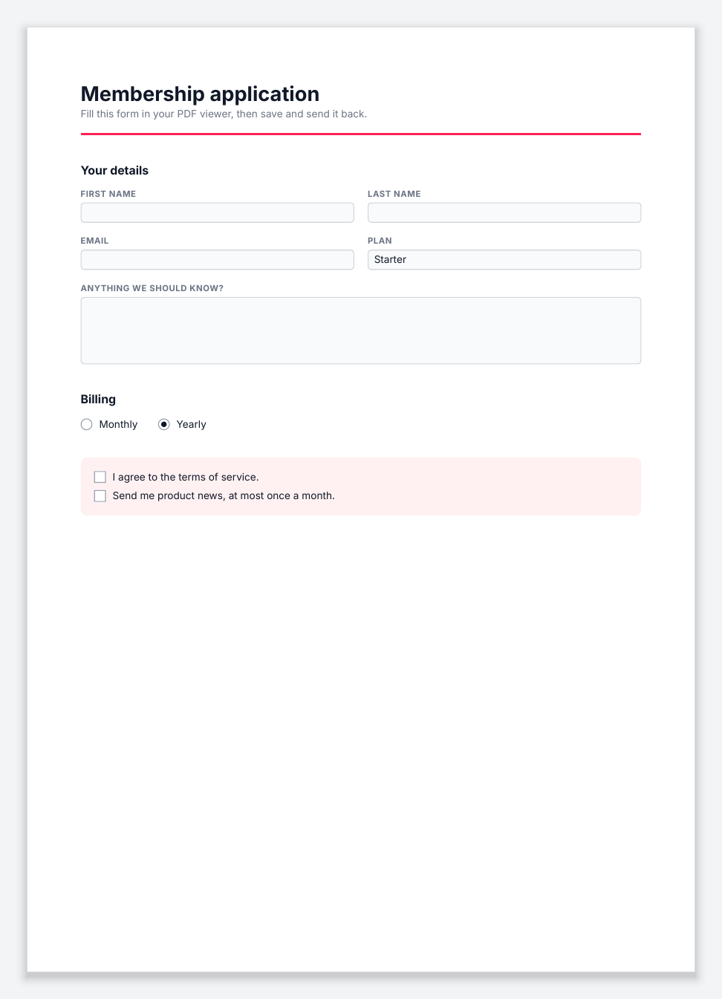

<div align="center">

# @inkoxide/render

**Print-quality PDFs from React components.**

[](https://www.npmjs.com/package/@inkoxide/render)
[](#licence)

[Quick start](#quick-start) · [Examples](#examples) · [Guide](GUIDE.md) · [API](GUIDE.md#api) · [Performance](#performance)

</div>

<p align="center">
  <a href="https://inkoxide.dev/playground/invoice"></a>
  <br>
  <sub>Edit a document in the <a href="https://inkoxide.dev/playground/invoice">playground</a>: it renders again in the browser, and Layout shows the boxes the engine laid out.</sub>
</p>

<!-- gallery:start (generated by examples/render.ts) -->

<table>
<tr>
<td align="center" valign="top" width="33%"><a href="#example-invoice"></a><br><sub><b>Invoice</b></sub></td>
<td align="center" valign="top" width="33%"><a href="#example-report"></a><br><sub><b>Multi-page report</b></sub></td>
<td align="center" valign="top" width="33%"><a href="#example-certificate"></a><br><sub><b>Certificate</b></sub></td>
</tr>
<tr>
<td align="center" valign="top" width="33%"><a href="#example-letter"></a><br><sub><b>Business letter</b></sub></td>
<td align="center" valign="top" width="33%"><a href="#example-resume"></a><br><sub><b>Résumé</b></sub></td>
<td align="center" valign="top" width="33%"><a href="#example-form"></a><br><sub><b>Fillable form</b></sub></td>
</tr>
</table>

<!-- gallery:end -->

@inkoxide/render turns React components into PDF documents. You write `Document`, `Page`,
`View` and `Text`, style them with Tailwind classes or style objects, and a layout engine
written in Rust does the typesetting: text shaping, line breaking, pagination and PDF output.

## Features

- **React and Tailwind.** Documents are components and their data are props. Style with
  Tailwind classes, compiled by Tailwind v4 itself, or with style objects in points.
- **Typesetting.** OpenType shaping, justification, hyphenation, orphans and widows, font
  fallback, right-to-left text, flexbox and CSS grid.
- **Pagination.** Tables that split across pages with repeating header rows, headers and
  footers, page numbers, keep-together blocks and page breaks.
- **Content.** JPEG, PNG, GIF, WebP and SVG images, vector drawing, links, bookmarks,
  fillable form fields and file attachments, Factur-X invoices among them.
- **Output.** Subset fonts, variable fonts, PDF/A (1b, 2b, 2a, 3b and 3a), tagged PDF and
  PDF/UA-1, encryption with passwords and permissions, and byte-identical output for identical
  input.
- **Diagnostics.** A component in the wrong place or an unknown style key fails with the
  component stack that produced it, and so does an unknown Tailwind class, except in
  production, where it is logged once and ignored.

## Quick start

```sh
npm install @inkoxide/render
```

To style with Tailwind classes (`className`), as the example does, add:

```sh
npm install @inkoxide/tailwind
```

Save this as `receipt.tsx`:

<!-- quickstart:start (generated by examples/render.ts) -->

```tsx
/** @jsxRuntime automatic */
import { Document, Page, renderToFile, Text, View } from '@inkoxide/render';

interface Line {
  name: string;
  amount: number;
}

export default function Receipt({ customer, lines }: { customer: string; lines: Line[] }) {
  const total = lines.reduce((sum, l) => sum + l.amount, 0);
  return (
    <Document title={`Receipt for ${customer}`}>
      <Page size="A6" className="p-8 text-xs text-gray-900">
        <Text className="text-lg font-bold">Receipt</Text>
        <Text className="mb-4 text-gray-500">for {customer}</Text>
        {lines.map((l) => (
          <View key={l.name} className="flex-row justify-between border-b border-gray-200 py-1.5">
            <Text>{l.name}</Text>
            <Text>${l.amount.toFixed(2)}</Text>
          </View>
        ))}
        <View className="mt-3 flex-row justify-between font-bold">
          <Text>Total</Text>
          <Text>${total.toFixed(2)}</Text>
        </View>
      </Page>
    </Document>
  );
}

export const sample = {
  customer: 'Ada Lovelace',
  lines: [
    { name: 'Espresso', amount: 3.2 },
    { name: 'Almond croissant', amount: 4.5 },
    { name: 'Sparkling water', amount: 2 },
  ],
};

renderToFile(<Receipt {...sample} />, 'receipt.pdf');
```

<!-- quickstart:end -->

Run it with `npx tsx receipt.tsx`, which writes `receipt.pdf`:


In a server, `renderToBuffer(<Receipt … />)` returns the bytes to send, and
`renderToStream(<Receipt … />)` a stream to pipe into the response.

## Examples

Six complete documents, one file each. Copy one, run it with `npx tsx`, and change it.

<!-- examples:start (generated by examples/render.ts) -->

<a id="example-invoice"></a>

### Invoice

An SVG logo, a table whose header repeats on every page, totals kept together and page numbers in the footer.

<details>
<summary>Source: <code>invoice.tsx</code></summary>

```tsx
/** @jsxRuntime automatic */
import {
  Cell,
  Circle,
  Document,
  Footer,
  Page,
  PageNumber,
  Path,
  Row,
  renderToFile,
  Svg,
  Table,
  Text,
  TotalPages,
  View,
} from '@inkoxide/render';

interface Party {
  name: string;
  address: string[];
  email: string;
}

interface Item {
  description: string;
  details?: string;
  quantity: number;
  price: number;
}

export interface InvoiceProps {
  number: string;
  issued: string;
  due: string;
  from: Party;
  to: Party;
  items: Item[];
  taxRate: number;
}

const money = (n: number) => n.toLocaleString('en-US', { style: 'currency', currency: 'USD' });
const percent = (n: number) => n.toLocaleString('en-US', { style: 'percent', maximumFractionDigits: 2 });

function Logo() {
  return (
    <Svg width={28} height={28} viewBox="0 0 32 32">
      <Circle cx={16} cy={16} r={16} fill="#4f46e5" />
      <Path
        d="M10 21 L16 9 L22 21 M12.5 16.5 H19.5"
        fill="none"
        stroke="white"
        strokeWidth={2.4}
        strokeLinecap="round"
      />
    </Svg>
  );
}

function Address({ label, party }: { label: string; party: Party }) {
  return (
    <View className="flex-1">
      <Text className="mb-1 text-[7.5pt] font-bold uppercase tracking-wider text-gray-400">{label}</Text>
      <Text className="font-bold">{party.name}</Text>
      {party.address.map((line) => (
        <Text key={line} className="text-gray-600">
          {line}
        </Text>
      ))}
      <Text className="text-gray-600">{party.email}</Text>
    </View>
  );
}

export default function Invoice({ number, issued, due, from, to, items, taxRate }: InvoiceProps) {
  const subtotal = items.reduce((sum, it) => sum + it.quantity * it.price, 0);
  const tax = subtotal * taxRate;
  const th = 'border-b border-gray-300 py-2 text-[7.5pt] font-bold uppercase tracking-wider text-gray-500';
  const td = 'border-b border-gray-100 py-2.5';

  return (
    <Document title={`Invoice ${number}`} author={from.name}>
      <Page size="A4" className="px-16 pt-14 pb-16 text-[9pt] text-gray-900">
        <Footer className="flex-row justify-between text-[7.5pt] text-gray-400">
          <Text>
            {from.name} · {from.email}
          </Text>
          <Text className="text-right">
            Page <PageNumber /> of <TotalPages />
          </Text>
        </Footer>

        <View className="mb-12 flex-row items-start justify-between">
          <View className="flex-row items-center gap-2.5">
            <Logo />
            <Text className="text-base font-bold">{from.name}</Text>
          </View>
          <View className="items-end">
            <Text className="text-3xl font-bold tracking-tight text-indigo-600">Invoice</Text>
            <Text className="text-gray-500">#{number}</Text>
          </View>
        </View>

        <View className="mb-10 flex-row gap-8">
          <Address label="From" party={from} />
          <Address label="Bill to" party={to} />
          <View className="w-32 gap-3">
            <View>
              <Text className="text-[7.5pt] font-bold uppercase tracking-wider text-gray-400">Issued</Text>
              <Text>{issued}</Text>
            </View>
            <View>
              <Text className="text-[7.5pt] font-bold uppercase tracking-wider text-gray-400">Due</Text>
              <Text className="font-bold">{due}</Text>
            </View>
          </View>
        </View>

        <Table columns={['1fr', 50, 80, 90]} headerRows={1}>
          <Row>
            <Cell className={th}>Description</Cell>
            <Cell className={`${th} text-right`}>Qty</Cell>
            <Cell className={`${th} text-right`}>Price</Cell>
            <Cell className={`${th} text-right`}>Amount</Cell>
          </Row>
          {items.map((it) => (
            <Row key={it.description}>
              <Cell className={td}>
                <Text className="font-bold">{it.description}</Text>
                {it.details && <Text className="text-gray-500">{it.details}</Text>}
              </Cell>
              <Cell className={`${td} text-right`}>{it.quantity}</Cell>
              <Cell className={`${td} text-right`}>{money(it.price)}</Cell>
              <Cell className={`${td} text-right font-bold`}>{money(it.quantity * it.price)}</Cell>
            </Row>
          ))}
        </Table>

        <View className="mt-6 ml-auto w-56 gap-1.5" break="avoid">
          <View className="flex-row justify-between text-gray-600">
            <Text>Subtotal</Text>
            <Text>{money(subtotal)}</Text>
          </View>
          <View className="flex-row justify-between text-gray-600">
            <Text>Tax ({percent(taxRate)})</Text>
            <Text>{money(tax)}</Text>
          </View>
          <View className="mt-1 flex-row justify-between rounded-md bg-indigo-50 px-3 py-2.5 text-sm font-bold text-indigo-700">
            <Text>Total due</Text>
            <Text>{money(subtotal + tax)}</Text>
          </View>
        </View>

        <View className="mt-12 rounded-md bg-gray-50 p-4 text-gray-600" break="avoid">
          <Text className="font-bold text-gray-900">Payment</Text>
          <Text>Bank transfer within 30 days. Please quote #{number} with your payment.</Text>
        </View>
      </Page>
    </Document>
  );
}

export const sample: InvoiceProps = {
  number: '2026-0142',
  issued: 'October 11, 2026',
  due: 'November 10, 2026',
  from: {
    name: 'Acme Studio',
    address: ['25 Harbor Street', 'Portland, OR 97204'],
    email: 'billing@acme.studio',
  },
  to: {
    name: 'Lincoln Elementary',
    address: ['4 Maple Avenue', 'Springfield, IL 62704'],
    email: 'office@lincoln.edu',
  },
  items: [
    { description: 'Brand identity', details: 'Logo, palette and type system', quantity: 1, price: 4800 },
    { description: 'Website design', details: 'Eight pages, desktop and mobile', quantity: 8, price: 650 },
    { description: 'Illustrations', details: 'Custom spot illustrations', quantity: 12, price: 180 },
    { description: 'Support', details: 'Hours, billed monthly', quantity: 6, price: 95 },
  ],
  taxRate: 0.08,
};

renderToFile(<Invoice {...sample} />, 'invoice.pdf');
```

</details>

<a id="example-report"></a>

### Multi-page report

Three KPI cards, a bar chart drawn with SVG, a 60-row table across three pages, a header from page 2 on, and bookmarks.

<details>
<summary>Source: <code>report.tsx</code></summary>

```tsx
/** @jsxRuntime automatic */
import {
  Cell,
  Document,
  Footer,
  Header,
  Page,
  PageNumber,
  Rect,
  Row,
  renderToFile,
  Svg,
  Table,
  Text,
  TotalPages,
  View,
} from '@inkoxide/render';

interface Sale {
  region: string;
  manager: string;
  units: number;
  revenue: number;
  growth: number;
}

export interface ReportProps {
  quarter: string;
  monthly: { month: string; revenue: number }[];
  sales: Sale[];
}

const usd = (n: number) =>
  n.toLocaleString('en-US', { style: 'currency', currency: 'USD', maximumFractionDigits: 0 });

function Kpi({ label, value, note }: { label: string; value: string; note: string }) {
  return (
    <View className="flex-1 rounded-lg border border-gray-200 p-4">
      <Text className="text-[7.5pt] font-bold uppercase tracking-wider text-gray-500">{label}</Text>
      <Text className="mt-1 text-xl font-bold">{value}</Text>
      <Text className="text-emerald-600">{note}</Text>
    </View>
  );
}

/** A bar chart drawn with SVG primitives. */
function Chart({ data }: { data: ReportProps['monthly'] }) {
  const max = Math.max(...data.map((d) => d.revenue));
  const w = 499; // the content width: A4 (595pt) minus the 48pt margins
  const h = 120;
  const bar = w / data.length;
  return (
    <View className="mb-8">
      <Svg width={w} height={h} viewBox={`0 0 ${w} ${h}`}>
        {data.map((d, i) => {
          const bh = (d.revenue / max) * (h - 8);
          return (
            <Rect
              key={d.month}
              x={i * bar + 6}
              y={h - bh}
              width={bar - 12}
              height={bh}
              rx={3}
              fill={i === data.length - 1 ? '#4f46e5' : '#c7d2fe'}
            />
          );
        })}
      </Svg>
      <View className="mt-1 flex-row" style={{ width: w }}>
        {data.map((d) => (
          <Text key={d.month} className="flex-1 text-center text-[7.5pt] text-gray-500">
            {d.month}
          </Text>
        ))}
      </View>
    </View>
  );
}

export default function Report({ quarter, monthly, sales }: ReportProps) {
  const revenue = sales.reduce((sum, s) => sum + s.revenue, 0);
  const units = sales.reduce((sum, s) => sum + s.units, 0);
  const th =
    'border-b border-gray-300 bg-gray-50 px-2 py-2 text-[7.5pt] font-bold uppercase tracking-wider text-gray-500';
  const td = 'border-b border-gray-100 px-2 py-1.5';

  return (
    <Document title={`Sales report ${quarter}`} author="Acme Studio">
      <Page size="A4" className="p-16 text-[8.5pt] text-gray-900">
        <Header className="flex-row justify-between text-[7.5pt] text-gray-400">
          <Text>Acme Studio</Text>
          <Text pages="notFirst">Sales report · {quarter}</Text>
        </Header>
        <Footer className="flex-row justify-between text-[7.5pt] text-gray-400">
          <Text>Confidential</Text>
          <Text className="text-right">
            Page <PageNumber /> of <TotalPages />
          </Text>
        </Footer>

        <Text className="text-3xl font-bold tracking-tight">Sales report, {quarter}</Text>
        <Text className="mb-8 text-sm text-gray-500">Revenue by region, with the month-by-month trend.</Text>

        <View className="mb-8 flex-row gap-3">
          <Kpi label="Revenue" value={usd(revenue)} note="+12.4% vs Q2" />
          <Kpi label="Units sold" value={units.toLocaleString('en-US')} note="+8.1% vs Q2" />
          <Kpi label="Regions" value={String(sales.length)} note="3 new this quarter" />
        </View>

        <Text className="mb-3 text-base font-bold" bookmark="Monthly revenue">
          Monthly revenue
        </Text>
        <Chart data={monthly} />

        <Text className="mb-3 text-base font-bold" bookmark="By region" break={{ minPresenceAhead: 120 }}>
          By region
        </Text>
        <Table columns={['1fr', '1fr', 50, 80, 50]} headerRows={1}>
          <Row>
            <Cell className={th}>Region</Cell>
            <Cell className={th}>Manager</Cell>
            <Cell className={`${th} text-right`}>Units</Cell>
            <Cell className={`${th} text-right`}>Revenue</Cell>
            <Cell className={`${th} text-right`}>Growth</Cell>
          </Row>
          {sales.map((s) => (
            <Row key={s.region}>
              <Cell className={`${td} font-bold`}>{s.region}</Cell>
              <Cell className={`${td} text-gray-600`}>{s.manager}</Cell>
              <Cell className={`${td} text-right`}>{s.units}</Cell>
              <Cell className={`${td} text-right`}>{usd(s.revenue)}</Cell>
              <Cell className={`${td} text-right ${s.growth < 0 ? 'text-rose-600' : 'text-emerald-600'}`}>
                {s.growth > 0 ? '+' : ''}
                {s.growth.toFixed(1)}%
              </Cell>
            </Row>
          ))}
        </Table>
      </Page>
    </Document>
  );
}

const cities = [
  'Amsterdam',
  'Berlin',
  'Chicago',
  'Denver',
  'Dublin',
  'Lisbon',
  'London',
  'Madrid',
  'Milan',
  'Montreal',
  'Oslo',
  'Paris',
  'Prague',
  'Seattle',
  'Seoul',
  'Singapore',
  'Stockholm',
  'Sydney',
  'Tokyo',
  'Toronto',
  'Vienna',
  'Warsaw',
  'Zurich',
];
const managers = [
  'Ada Lovelace',
  'Grace Hopper',
  'Alan Turing',
  'Katherine Johnson',
  'Linus Torvalds',
  'Margaret Hamilton',
];

export const sample: ReportProps = {
  quarter: 'Q3 2026',
  monthly: ['Jan', 'Feb', 'Mar', 'Apr', 'May', 'Jun', 'Jul', 'Aug', 'Sep'].map((month, i) => ({
    month,
    revenue: 180_000 + i * 14_000 + (i % 3) * 9_000,
  })),
  sales: Array.from({ length: 60 }, (_, i) => ({
    region: `${cities[i % cities.length]} ${Math.floor(i / cities.length) + 1}`,
    manager: managers[i % managers.length] as string,
    units: 120 + ((i * 37) % 300),
    revenue: 18_000 + ((i * 7_919) % 64_000),
    growth: ((i * 13) % 40) - 9.5,
  })),
};

renderToFile(<Report {...sample} />, 'report.pdf');
```

</details>

<a id="example-certificate"></a>

### Certificate

A landscape page, nested borders, the Inter Display face, a drawn seal and an absolutely positioned serial number.

<details>
<summary>Source: <code>certificate.tsx</code></summary>

```tsx
/** @jsxRuntime automatic */
import { Circle, Document, Page, Path, renderToFile, Svg, Text, View } from '@inkoxide/render';

export interface CertificateProps {
  recipient: string;
  course: string;
  hours: number;
  date: string;
  id: string;
}

/** A rosette seal drawn with SVG. */
function Seal() {
  const points = Array.from({ length: 24 }, (_, i) => {
    const a = (i * Math.PI) / 12;
    const r = i % 2 === 0 ? 46 : 40;
    return `${50 + r * Math.cos(a)},${50 + r * Math.sin(a)}`;
  });
  return (
    <Svg width={84} height={84} viewBox="0 0 100 100">
      <Path d={`M${points.join(' L')} Z`} fill="#b45309" />
      <Circle cx={50} cy={50} r={34} fill="#f59e0b" />
      <Circle cx={50} cy={50} r={28} fill="none" stroke="#fef3c7" strokeWidth={1.5} />
      <Path
        d="M38 51 L46 59 L63 41"
        fill="none"
        stroke="white"
        strokeWidth={5}
        strokeLinecap="round"
        strokeLinejoin="round"
      />
    </Svg>
  );
}

function Signature({ name, caption }: { name: string; caption: string }) {
  return (
    <View className="w-48 items-center">
      <View className="mb-2 w-full border-b border-stone-400" />
      <Text className="font-bold">{name}</Text>
      <Text className="text-stone-500">{caption}</Text>
    </View>
  );
}

export default function Certificate({ recipient, course, hours, date, id }: CertificateProps) {
  return (
    <Document title={`Certificate: ${recipient}`}>
      <Page size="A4-landscape" className="bg-amber-50 p-6 text-[9pt] text-stone-800">
        <View className="flex-1 border-2 border-amber-700 p-1.5">
          <View className="flex-1 items-center border border-amber-700/50 px-20 py-12">
            <Text className="text-[8pt] font-bold uppercase tracking-[0.4em] text-amber-700">
              Acme Academy
            </Text>
            <View className="flex-1 items-center justify-center">
              <Text className="font-display text-[40pt] text-stone-900">Certificate of Completion</Text>
              <Text className="mt-4 text-sm text-stone-500">This certifies that</Text>
              <Text className="mt-4 border-b border-amber-700/40 px-10 pb-2 font-display text-[30pt] text-amber-800">
                {recipient}
              </Text>
              <Text className="mt-5 max-w-md text-center text-sm leading-relaxed text-stone-600">
                has completed <Text className="font-bold text-stone-900">{course}</Text>, a {hours}-hour
                course with practical assessments, and is awarded this certificate.
              </Text>
            </View>
            <View className="w-full flex-row items-end justify-between">
              <Signature name="Grace Hopper" caption="Course director" />
              <Seal />
              <Signature name={date} caption="Date of issue" />
            </View>
          </View>
        </View>
        <Text className="absolute right-10 bottom-2 text-[6.5pt] text-stone-400">Certificate {id}</Text>
      </Page>
    </Document>
  );
}

export const sample: CertificateProps = {
  recipient: 'Ada Lovelace',
  course: 'Designing Documents with React',
  hours: 24,
  date: 'October 11, 2026',
  id: 'AA-2026-0815',
};

renderToFile(<Certificate {...sample} />, 'certificate.pdf');
```

</details>

<a id="example-letter"></a>

### Business letter

US Letter, justified and hyphenated paragraphs, a mailto: link and a footer between the page margins.

<details>
<summary>Source: <code>letter.tsx</code></summary>

```tsx
/** @jsxRuntime automatic */
import { Document, Footer, Page, renderToFile, Text, View } from '@inkoxide/render';

export interface LetterProps {
  date: string;
  to: string[];
  greeting: string;
  paragraphs: string[];
  sender: { name: string; title: string };
}

export default function Letter({ date, to, greeting, paragraphs, sender }: LetterProps) {
  return (
    <Document title="Letter" author={sender.name} lang="en-US">
      <Page size="Letter" className="px-24 pt-20 pb-24 text-[10.5pt] leading-relaxed text-slate-800">
        <Footer className="text-[7.5pt] text-slate-400">
          <View className="flex-row justify-between border-t border-slate-200 pt-3">
            <Text>Northwind Labs · 500 Market Street, San Francisco, CA 94105</Text>
            <Text href="mailto:hello@northwind.dev">hello@northwind.dev</Text>
          </View>
        </Footer>

        <View className="mb-14 flex-row items-center gap-2">
          <View className="h-3 w-3 rotate-45 bg-teal-600" />
          <Text className="text-base font-bold tracking-tight text-slate-900">Northwind Labs</Text>
        </View>

        <Text className="mb-8 text-slate-500">{date}</Text>
        <View className="mb-8">
          {to.map((line) => (
            <Text key={line}>{line}</Text>
          ))}
        </View>

        <Text className="mb-4">{greeting}</Text>
        {paragraphs.map((p) => (
          <Text key={p.slice(0, 24)} className="mb-3 text-justify" hyphenate>
            {p}
          </Text>
        ))}

        <View className="mt-6" break="avoid">
          <Text>Kind regards,</Text>
          <Text className="mt-10 font-bold text-slate-900">{sender.name}</Text>
          <Text className="text-slate-500">{sender.title}</Text>
        </View>
      </Page>
    </Document>
  );
}

export const sample: LetterProps = {
  date: 'October 11, 2026',
  to: ['Dr. Katherine Johnson', 'Langley Research Institute', '1 Discovery Way', 'Hampton, VA 23666'],
  greeting: 'Dear Dr. Johnson,',
  paragraphs: [
    'Thank you for meeting with our team last week. We were delighted by your interest in using our trajectory toolkit for the institute’s upcoming programme, and we have prepared the proposal you asked for, together with an estimate of the integration work.',
    'In summary, we would provide the analysis libraries under an institutional licence, train two members of your staff over the first month, and remain available for consultation throughout the project. The enclosed schedule shows a first milestone eight weeks after signature, with weekly progress reports in between.',
    'We understand that verification matters more than speed in this work. Every calculation the toolkit performs can be exported and checked independently, and we would welcome your team reviewing the methods before any results are relied upon.',
    'Please let us know if you would like to discuss the details in person. We look forward to working with you.',
  ],
  sender: { name: 'Margaret Hamilton', title: 'Director of Engineering' },
};

renderToFile(<Letter {...sample} />, 'letter.pdf');
```

</details>

<a id="example-resume"></a>

### Résumé

A CSS grid with a full-height sidebar, tags that wrap, and jobs that never split across pages.

<details>
<summary>Source: <code>resume.tsx</code></summary>

```tsx
/** @jsxRuntime automatic */
import { Document, Page, renderToFile, Text, View } from '@inkoxide/render';

interface Job {
  role: string;
  company: string;
  period: string;
  points: string[];
}

export interface ResumeProps {
  name: string;
  title: string;
  contact: string[];
  summary: string;
  skills: { group: string; items: string[] }[];
  jobs: Job[];
  education: { degree: string; school: string; year: string }[];
}

function Section({ title, children }: { title: string; children: React.ReactNode }) {
  return (
    <View className="mb-6">
      <Text className="mb-3 text-[7.5pt] font-bold uppercase tracking-widest text-sky-700">{title}</Text>
      {children}
    </View>
  );
}

export default function Resume({ name, title, contact, summary, skills, jobs, education }: ResumeProps) {
  return (
    <Document title={`${name} — Résumé`} author={name}>
      <Page size="A4" className="text-[8.5pt] leading-snug text-slate-800">
        <View className="grid flex-1 grid-cols-[170pt_1fr]">
          <View className="bg-slate-900 px-8 py-12 text-slate-300">
            <View className="mb-5 h-16 w-16 items-center justify-center rounded-full bg-sky-500">
              <Text className="text-xl font-bold text-white">
                {name
                  .split(' ')
                  .map((n) => n[0])
                  .join('')}
              </Text>
            </View>
            <Text className="text-xl font-bold leading-tight text-white">{name}</Text>
            <Text className="mb-8 text-sky-300">{title}</Text>

            <Text className="mb-2 text-[7.5pt] font-bold uppercase tracking-widest text-slate-400">
              Contact
            </Text>
            <View className="mb-8 gap-1">
              {contact.map((c) => (
                <Text key={c}>{c}</Text>
              ))}
            </View>

            {skills.map((s) => (
              <View key={s.group} className="mb-5">
                <Text className="mb-2 text-[7.5pt] font-bold uppercase tracking-widest text-slate-400">
                  {s.group}
                </Text>
                <View className="flex-row flex-wrap gap-1">
                  {s.items.map((it) => (
                    <Text key={it} className="rounded bg-slate-800 px-1.5 py-0.5 text-[7.5pt] text-slate-200">
                      {it}
                    </Text>
                  ))}
                </View>
              </View>
            ))}
          </View>

          <View className="px-10 py-12">
            <Section title="Profile">
              <Text className="text-[9pt] leading-relaxed text-slate-600">{summary}</Text>
            </Section>

            <Section title="Experience">
              {jobs.map((j) => (
                <View key={j.company} className="mb-4" break="avoid">
                  <View className="flex-row items-baseline justify-between">
                    <Text className="text-[10pt] font-bold text-slate-900">{j.role}</Text>
                    <Text className="text-slate-400">{j.period}</Text>
                  </View>
                  <Text className="mb-1.5 text-sky-700">{j.company}</Text>
                  {j.points.map((p) => (
                    <View key={p} className="mb-0.5 flex-row gap-2">
                      <Text className="text-sky-500">•</Text>
                      <Text className="flex-1 text-slate-600">{p}</Text>
                    </View>
                  ))}
                </View>
              ))}
            </Section>

            <Section title="Education">
              {education.map((e) => (
                <View key={e.degree} className="flex-row justify-between">
                  <View>
                    <Text className="font-bold text-slate-900">{e.degree}</Text>
                    <Text className="text-slate-500">{e.school}</Text>
                  </View>
                  <Text className="text-slate-400">{e.year}</Text>
                </View>
              ))}
            </Section>
          </View>
        </View>
      </Page>
    </Document>
  );
}

export const sample: ResumeProps = {
  name: 'Grace Hopper',
  title: 'Principal Software Engineer',
  contact: ['grace@example.com', '+1 (555) 010-1906', 'Arlington, VA', 'github.com/ghopper'],
  summary:
    'Engineer with twenty years of experience building compilers, developer tools and the teams that ship them. I care about making machines speak the language of the people who use them, and about documentation that is as carefully made as the code.',
  skills: [
    { group: 'Languages', items: ['TypeScript', 'Rust', 'COBOL', 'Go', 'SQL'] },
    { group: 'Systems', items: ['Compilers', 'Distributed systems', 'PostgreSQL', 'Kubernetes'] },
    { group: 'Leadership', items: ['Mentoring', 'Hiring', 'Technical writing'] },
  ],
  jobs: [
    {
      role: 'Principal Engineer',
      company: 'Compiler Systems Inc.',
      period: '2019 — now',
      points: [
        'Led the rewrite of the code generator, cutting build times by 60% across 400 services.',
        'Designed the plugin API now used by eleven internal teams.',
        'Mentored eight engineers, four of whom became tech leads.',
      ],
    },
    {
      role: 'Senior Engineer',
      company: 'Eckert-Mauchly Computers',
      period: '2013 — 2019',
      points: [
        'Built the first English-like query language for the reporting platform.',
        'Introduced code review and automated testing to a team of thirty.',
      ],
    },
    {
      role: 'Software Engineer',
      company: 'Harvard Computation Lab',
      period: '2008 — 2013',
      points: [
        'Maintained the operating manuals and the subroutine library.',
        'Found and documented the first actual bug.',
      ],
    },
  ],
  education: [
    { degree: 'Ph.D., Mathematics', school: 'Yale University', year: '2008' },
    { degree: 'B.A., Mathematics and Physics', school: 'Vassar College', year: '2003' },
  ],
};

renderToFile(<Resume {...sample} />, 'resume.pdf');
```

</details>

<a id="example-form"></a>

### Fillable form

Text fields, a select, radio buttons and checkboxes that can be filled in any PDF viewer.

<details>
<summary>Source: <code>form.tsx</code></summary>

```tsx
/** @jsxRuntime automatic */
import {
  Checkbox,
  Document,
  Page,
  Radio,
  renderToFile,
  Select,
  Text,
  TextField,
  View,
} from '@inkoxide/render';

export interface FormProps {
  title: string;
  plans: string[];
}

const input = 'h-6 w-full rounded border border-gray-300 bg-gray-50 px-1 text-[9pt]';

function Field({ label, children }: { label: string; children: React.ReactNode }) {
  return (
    <View className="flex-1 gap-1">
      <Text className="text-[7.5pt] font-bold uppercase tracking-wider text-gray-500">{label}</Text>
      {children}
    </View>
  );
}

/** A fillable PDF form: the fields can be typed into in any PDF viewer. */
export default function Form({ title, plans }: FormProps) {
  return (
    <Document title={title}>
      <Page size="A4" className="p-16 text-[9pt] text-gray-900">
        <View className="mb-8 border-b-2 border-rose-500 pb-4">
          <Text className="text-2xl font-bold">{title}</Text>
          <Text className="text-gray-500">
            Fill this form in your PDF viewer, then save and send it back.
          </Text>
        </View>

        <Text className="mb-3 text-sm font-bold">Your details</Text>
        <View className="mb-4 flex-row gap-4">
          <Field label="First name">
            <TextField name="firstName" className={input} />
          </Field>
          <Field label="Last name">
            <TextField name="lastName" className={input} />
          </Field>
        </View>
        <View className="mb-4 flex-row gap-4">
          <Field label="Email">
            <TextField name="email" className={input} />
          </Field>
          <Field label="Plan">
            <Select name="plan" options={plans} value={plans[0]} className={input} />
          </Field>
        </View>
        <View className="mb-8">
          <Field label="Anything we should know?">
            <TextField
              name="notes"
              multiline
              className="h-20 w-full rounded border border-gray-300 bg-gray-50 p-1 text-[9pt]"
            />
          </Field>
        </View>

        <Text className="mb-3 text-sm font-bold">Billing</Text>
        <View className="mb-8 flex-row gap-6">
          {['Monthly', 'Yearly'].map((period) => (
            <View key={period} className="flex-row items-center gap-2">
              <Radio
                name="billing"
                value={period}
                checked={period === 'Yearly'}
                className="h-3.5 w-3.5 rounded-full border border-gray-400"
              />
              <Text>{period}</Text>
            </View>
          ))}
        </View>

        <View className="gap-2 rounded-lg bg-rose-50 p-4">
          {['I agree to the terms of service.', 'Send me product news, at most once a month.'].map(
            (label, i) => (
              <View key={label} className="flex-row items-center gap-2">
                <Checkbox name={`consent${i}`} className="h-3.5 w-3.5 border border-gray-400 bg-white" />
                <Text>{label}</Text>
              </View>
            ),
          )}
        </View>
      </Page>
    </Document>
  );
}

export const sample: FormProps = {
  title: 'Membership application',
  plans: ['Starter', 'Team', 'Enterprise'],
};

renderToFile(<Form {...sample} />, 'form.pdf');
```

</details>

<!-- examples:end -->

## Documentation

| Document | Contents |
|---|---|
| [Guide](GUIDE.md) | Components, styling, fonts, images, pagination, tables, links, drawing and forms |
| [Accessibility](GUIDE.md#accessibility) | Tagged PDF, PDF/UA-1 and 2: `tagged`, `pdfUA`, roles and alternate text |
| [Attachments](GUIDE.md#attachments) | Files embedded in the PDF, `<Attachment>`, and Factur-X invoices |
| [API](GUIDE.md#api) | `renderToBuffer`, `renderToFile`, `renderToStream` and their options, `Font.register`, `init`, health checks, concurrency |
| [Errors](GUIDE.md#errors) | Error codes and what they mean |
| [Serving templates](GUIDE.md#serving-templates) | Templates by id, with a zod schema for their data: `@inkoxide/render/templates` |
| [In the browser](GUIDE.md#in-the-browser) | `@inkoxide/render/browser`: `usePdf`, `<PdfViewer>`, `<PdfDownloadLink>`, `<BlobProvider>`, `renderToBlob`, `renderToStream`, local files, a CDN, bundlers and Content Security Policy |
| [FAQ](GUIDE.md#faq) | Installing on servers and in Docker, hooks, page numbers, determinism |

## Performance

[Benchmarks](https://github.com/eddiesr93/inkoxide/blob/main/docs/BENCHMARKS.md) has the render
times, on the server and in the browser, and how they were measured.

## Requirements

- **Node.js 22 or later**, ES modules.
- **Platforms:** npm installs the prebuilt engine for the current platform; see
  [Platforms](https://github.com/eddiesr93/inkoxide#platforms).
- **Browsers:** `@inkoxide/render/browser`, with `@inkoxide/wasm` installed, renders in a Web
  Worker ([In the browser](GUIDE.md#in-the-browser)).

## Licence

MIT, for this package and for the Inkoxide engine. The bundled fonts (Inter, Inter Display,
Noto Sans, Roboto Mono) are under the SIL Open Font License 1.1, and the US English hyphenation
patterns keep the licence in their file header; `assets/NOTICE.md` lists them.
